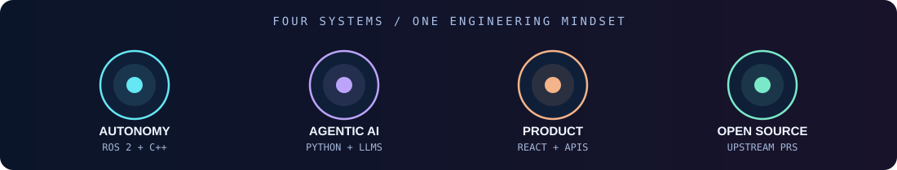

### Building intelligent systems that move from prototype to production-minded engineering.

**M.S. Computer & Information Science @ Texas A&M University–Corpus Christi** · **Teaching Assistant** · **Graduating Dec 2027**

[**🏠 Home**](#-hello-im-maharshi) · [**🔀 Open Source**](#-upstream-open-source-contributions) · [**🚀 Projects**](#-flagship-projects) · [**🧪 Lab**](#-other-things-ive-built) · [**⚙️ Stack**](#-engineering-stack) · [**📈 Activity**](#-engineering-activity)

---

## 👋 Hello, I'm Maharshi

I engineer software where **AI, autonomous systems, security, developer tooling, and real-world products** intersect. My work ranges from ROS 2 warehouse navigation and AI-powered developer tools to mobile applications, data systems, and contributions to widely used open-source projects.

> **Engineering philosophy:** Don't just ship a demo. Make the behavior reproducible, test the failure paths, document the trade-offs, and leave the next engineer with something maintainable.

- 🛠️ **Currently exploring:** agentic systems, C++ systems engineering, robotics, reliable automation and platform software.
- 🎓 **Education:** M.S. in Computer & Information Science, Texas A&M University–Corpus Christi (in progress).
- 👨‍🏫 **Teaching:** Teaching Assistant supporting undergraduate programming labs.
- 🤝 **Open source:** Fixing real bugs in upstream projects—not claiming a contribution is merged until maintainers actually merge it.
- 🧭 **Explore the interactive experience:** [maharshi-os.netlify.app](https://maharshi-os.netlify.app/).

## 🔀 Upstream Open-Source Contributions

**This is work proposed to other maintainers' repositories.** It's separate from my own project development. The lists below are periodically updated from GitHub's recorded PR states, so **merged** and **open** are never treated as synonyms.

<!-- UPSTREAM-PR-START -->

### ✅ Merged upstream

| Repository | Engineering contribution | PR |
| :-- | :-- | :-- |
| **Tesla · vehicle-command** | Make the HTTP proxy exit with failure and report startup errors to stderr | [#524](https://github.com/teslamotors/vehicle-command/pull/524) |
| **ROS Navigation2** | Correct action cancellation when halted before the goal is acknowledged | [#6445](https://github.com/ros-navigation/navigation2/pull/6445) |

### 🟣 Open upstream

| Repository | Engineering contribution | PR |
| :-- | :-- | :-- |
| **Tesla · vehicle-command** | Propagate request cancellation and clean up proxy startup behavior | [#535](https://github.com/teslamotors/vehicle-command/pull/535) |
| **Google DeepMind · MuJoCo** | Correct native macOS viewer threading | [#3697](https://github.com/google-deepmind/mujoco/pull/3697) |
| **Meta · Mariana Trench** | Repair static-field taint propagation and add regression coverage | [#277](https://github.com/facebook/mariana-trench/pull/277) |
| **Meta · Pyrefly** | Preserve Unknown while narrowing missing attributes | [#5346](https://github.com/facebook/pyrefly/pull/5346) |
| **MoveIt2** | Prevent a shutdown-time use-after-free in keyboard servo demo | [#3850](https://github.com/moveit/moveit2/pull/3850) |
| **Meta · ThreatExchange** | Prevent signed integer overflow in PDQ image downscaling | [#2026](https://github.com/facebook/ThreatExchange/pull/2026) |
| **Supabase** | Show removed edge functions correctly in branch merge differences | [#44194](https://github.com/supabase/supabase/pull/44194) |
| **Tesla · react-native-camera-kit** | Center Android scan overlay after enablement and layout changes | [#822](https://github.com/teslamotors/react-native-camera-kit/pull/822) |
| **Waymo · Waymax** | Fix scenario-ID batching in WOSAC notebook | [#96](https://github.com/waymo-research/waymax/pull/96) |
| **Waymo · Waymax** | Clarify rollout actor state/observation contract and add test | [#95](https://github.com/waymo-research/waymax/pull/95) |
| **Waymo · Waymax** | Fix configured simulation actors in dm_env factory | [#94](https://github.com/waymo-research/waymax/pull/94) |

[Browse all my pull requests →](https://github.com/pulls?q=is%3Apr+author%3Amaharshi-coding)

<!-- UPSTREAM-PR-END -->

<b>🧾 What do these statuses mean?</b>

- ✅ **Merged upstream:** Maintainers incorporated the PR into their repository.
- 🟣 **Open upstream:** The PR has been submitted but is not yet merged.
- ⚪ **Closed without merge:** Preserved in GitHub history, not represented as accepted upstream work.
- 🏗️ **Own project PR:** Development work in my own repositories; not counted as external open-source impact.

See [closed / unmerged PRs](https://github.com/pulls?q=is%3Apr+author%3Amaharshi-coding+is%3Aclosed+-is%3Amerged). GitHub Actions can refresh the two upstream sections on a schedule.

---

## 🚀 Flagship Projects

Original work I designed, built, or co-built, **not forks presented as independent products**.

<table>
<tr>
<td width="50%" valign="top">

### 🤖 [FulfillFlow](https://github.com/maharshi-coding/FulfillFlow)

**ROS 2 warehouse autonomous mobile robot**

C++20 · ROS 2 Jazzy · Gazebo Harmonic · Nav2 · AMCL

A custom 32 kg differential-drive AMR with LiDAR, IMU, localization, route planning, obstacle avoidance and recovery behavior. **M2 single-robot navigation verified; multi-robot fleet features remain planned.**

[**Explore source →**](https://github.com/maharshi-coding/FulfillFlow)

</td>
<td width="50%" valign="top">

### 🧠 [OSS-Agent](https://github.com/maharshi-coding/oss-agent)

**Human-in-the-loop open-source contribution agent**

Python · Agent orchestration · Git · CLI · Testing

Coordinates repository investigation, patch proposals, review and regression testing while requiring human approval to publish. Includes **176 tests** and **76% test coverage** as documented by the project.

[**Live interactive visualizer →**](https://maharshi-coding.github.io/oss-agent/)

</td>
</tr>
<tr>
<td valign="top">

### 🚗 [Campus Ride](https://github.com/maharshi-coding/ride-share)

**Student ride-pooling mobile application**

React Native · TypeScript · Firebase · Mapbox · Stripe

End-to-end Android/iOS ride sharing with student identity checks, maps, chat, ride creation, payments and release engineering.

[**Android app →**](https://play.google.com/store/apps/details?id=com.maharshibarot.campusride)

</td>
<td valign="top">

### 🛡️ [Seller Shield](https://github.com/maharshi-coding/seller-shield)

**Seller-protection multi-agent workflow**

AWS Bedrock · Strands Agents SDK · Python · React

Four specialized agents coordinate risk monitoring, supporting evidence, human-reviewed claims/appeals and escalation tracking.

[**Explore architecture →**](https://github.com/maharshi-coding/seller-shield)

</td>
</tr>
<tr>
<td valign="top">

### 💧 [AquaReclaim TX](https://github.com/maharshi-coding/AquaReclaim-TX)

**AI-assisted rural water-loss intelligence**

IoT · Telemetry · Anomaly detection · AI copilot

Co-built to help rural water utilities interpret flow/pressure anomalies, prioritize response and track evidence. **Zoho hackathon finalist project.**

[**Inspect the solution →**](https://github.com/maharshi-coding/AquaReclaim-TX)

</td>
<td valign="top">

### ⚖️ [Overturn](https://github.com/maharshi-coding/overturn)

**Agentic insurance-appeal orchestration**

Node.js · Cloud Run · Firebase · Multi-step agents

Automates document intake, policy-aware appeal drafting and stateful follow-up workflows, with retries and persistent case state.

[**Explore source →**](https://github.com/maharshi-coding/overturn)

</td>
</tr>
<tr>
<td valign="top">

### 🌊 [OutfallWatch](https://github.com/maharshi-coding/outfallwatch)

**Coastal change-detection and early warning**

ESP32 · Edge sensing · FastAPI · Telemetry

Low-power stormwater condition monitoring with edge decisions, adaptive transmission, a real-time dashboard and offline storm simulation.

[**Live demo →**](https://outfallwatch.onrender.com)

</td>
<td valign="top">

### 🔬 [XAIFlow](https://github.com/maharshi-coding/XAIFlow)

**Explainable machine learning orchestration**

React Flow · Python · PostgreSQL · SHAP/LIME

Visual ML pipelines, experimental lineage, model serving, explanations, monitoring and recoverable model artifacts.

[**Explore platform →**](https://github.com/maharshi-coding/XAIFlow)

</td>
</tr>
</table>

## 🧪 Other Things I've Built

<b>🧠 AI, agents & developer experience</b>

| Project | What it does |
| :-- | :-- |
| [Agent Pixel Visualizer](https://github.com/maharshi-coding/agent-pixel-visualizer) | VS Code activity rendered as an interactive pixel-art world |
| [DataHub Steward Squad](https://github.com/maharshi-coding/datahub-steward-squad) | Multi-agent metadata governance and approval-gated DataHub MCP writeback |
| [AI Tutor](https://github.com/maharshi-coding/ai-tutor-app) | AI tutoring, document RAG and narrated avatar briefings |
| [Face Attendance](https://github.com/maharshi-coding/face-attendance-app) | Self-hosted attendance with face embeddings and role-based access |
| [KAN-ODEs](https://github.com/maharshi-coding/KAN-ODEs) | Numerical learning and Kolmogorov-Arnold network experiments |
| [AIRS](https://github.com/maharshi-coding/reinforcement-learning) | Reinforcement-learning experiments for adaptive intrusion response |

<b>🎮 Interactive experiences & creative engineering</b>

| Project | What it does |
| :-- | :-- |
| [MaharshiOS](https://github.com/maharshi-coding/maharshi-os) | Game-inspired interactive developer portfolio |
| [UNO Chess](https://github.com/maharshi-coding/UNO-Chess) | Kotlin Multiplatform chess/UNO hybrid |
| [Orlog Game](https://github.com/maharshi-coding/orlog-game) | Interactive dice-based strategy game |
| [ChessConnect](https://github.com/maharshi-coding/ChessConnect) | Multi-agent engineering workspace for a social chess platform |
| [Instagram Post Creator TUI](https://github.com/maharshi-coding/Instagram_Post_Creator_TUI) | Go terminal UI for media planning and publishing workflows |

<b>📦 Browse every public repository, including experiments & forks</b>

Not every repository is a flagship project. Forks, sandboxes and experiments are kept discoverable without confusing them with original products.

[**All public repositories and latest changes →**](https://github.com/maharshi-coding?tab=repositories)

---

## ⚙️ Engineering Stack

| Focus | Tools & patterns |
| :-- | :-- |
| **Intelligent systems** | LLM agents, RAG, evaluation, orchestration, approval-gated automation |
| **Robotics / systems** | ROS 2, Nav2, Gazebo, C++20, sensors, localization, path planning |
| **Backend & cloud** | Python, Node.js, FastAPI, REST APIs, AWS, GCP, Docker, SQL |
| **Web & mobile** | React, React Native, Next.js, TypeScript, Firebase, Mapbox |
| **Engineering quality** | GitHub Actions, automated testing, observability, regression validation |

## 📈 Engineering Activity

<b>📌 How to read the activity charts</b>

Language charts reflect public GitHub repositories, not proficiency. Third-party stats services may occasionally rate-limit or fail to render. My contributions above link directly to the underlying code and upstream PRs.

---

## 🌐 Let's Build Something Useful

I'm interested in **Summer 2027 software engineering, robotics, AI infrastructure, backend and systems engineering internships**, along with serious open-source collaboration.

**[Explore my portfolio](https://maharshi-os.netlify.app/)** · **[See my projects](https://github.com/maharshi-coding?tab=repositories)** · **[See my pull requests](https://github.com/pulls?q=is%3Apr+author%3Amaharshi-coding)**

*Ideas become interesting when they survive contact with real systems.*

**Built with curiosity. Tested with intention. Shared in the open.**

