<div align="center">

<a href="https://maharshi-coding.github.io/maharshi-coding/"></a>


**`PLAYER 01`** · **`MAHARSHI BAROT`** · **`FULL-STACK MAGE / AI SUMMONER`** · **`NEON VOID // V3`**

[](https://maharshi-coding.github.io/maharshi-coding/)
[](#-level-03--game-library)
[](#-level-02--raid-log)

</div>

```text
╔══════════════════════════════════════════════════════════════════╗
║   MAHARSHI.EXE  [LOAD FILE 01]                 STATUS: ONLINE    ║
╠══════════════════════════════════════════════════════════════════╣
║  [01] CHARACTER SHEET    [02] RAID LOG       [03] GAME LIBRARY  ║
║  [04] SKILL TREE         [05] ACHIEVEMENTS   [06] SNAKE.exe     ║
╚══════════════════════════════════════════════════════════════════╝
```

<div align="center">

[**01 / PLAYER**](#-level-01--character-sheet) &nbsp; [**02 / QUESTS**](#-level-02--raid-log) &nbsp; [**03 / GAMES**](#-level-03--game-library) &nbsp; [**04 / SKILLS**](#-level-04--skill-tree) &nbsp; [**05 / STATS**](#-level-05--achievements--hud) &nbsp; [**06 / ARCADE**](#-level-06--the-snake-minigame)

</div>

---

## 🧙 LEVEL 01 // CHARACTER SHEET

```text
┌ PLAYER FILE ───────────────────────────────────────────────────────┐
│ NAME          Maharshi Barot                                      │
│ CLASS         Full-Stack Mage / AI Summoner                       │
│ BASE CAMP     Texas A&M University–Corpus Christi                │
│ ACADEMY       M.S. Computer & Information Science (in progress)  │
│ CLASS QUEST   Software Developer @ Meeka                         │
│ GUILD ROLE    Teaching Assistant                                 │
│ SPECIALTY     AI agents / robotics / developer tools / products   │
│ VICTORY       Real software. Real tests. Real upstream fixes.     │
└───────────────────────────────────────────────────────────────────┘
```

**Origin story:** I turn ideas into working systems — from autonomous warehouse robotics and LLM agents to real-time mobile applications, trustworthy APIs, and patches for existing open-source maintainers. I believe good engineering means making the happy path work *and* proving the failure path behaves.

> 🗞️ **Legendary side quest · RAMAYANAGPT:** A domain-specific AI conversational assistant listed in my earlier profile. No verified public repository or demo URL was found, so this quest has no invented CODE/PLAY link.

**Mission objective:** Build things that are useful, testable and genuinely fun to explore.  
**Quest-giver:** [Interactive portfolio](https://maharshi-os.netlify.app/) · [GitHub](https://github.com/maharshi-coding)

<details><summary><b>📜 OPEN CHARACTER BACKSTORY</b></summary>

- Graduate student at Texas A&M University–Corpus Christi.
- Teaching Assistant for undergraduate programming labs.
- Working across full-stack engineering, AI, robot autonomy and community-maintained code.
- The job at Meeka is shown as the **current quest you supplied**, not independently verified from GitHub.

</details>

---

## ⚔️ LEVEL 02 // RAID LOG

<code>SYNC PROTOCOL: GITHUB API</code> · <code>PUBLIC PRs ONLY</code> · <code>STATE-AWARE</code>

Bounties from other engineering guilds are marked **⚔️ upstream**. Work in my own public repositories is marked **🏠 home-base**. **Merged** means GitHub confirms the PR was merged, while **open** means it is still awaiting a decision.

<!--START_SECTION:prs-->
### Merged upstream · 2

| Project | Contribution | PR |
| :-- | :-- | :-- |
| **teslamotors/vehicle-command** | tesla-http-proxy: exit 1 and report startup failures on stderr | [#524](https://github.com/teslamotors/vehicle-command/pull/524) |
| **ros-navigation/navigation2** | Fix BtActionNode cancellation when halted before goal acknowledgement | [#6445](https://github.com/ros-navigation/navigation2/pull/6445) |

<details><summary>View 7 merged PRs in my own GitHub namespace</summary>

| Repository | Change | Pull request |
| :-- | :-- | :-- |
| maharshi-coding/oss-agent | Interactive README + live GitHub Pages visualizer demo | [#1](https://github.com/maharshi-coding/oss-agent/pull/1) |
| maharshi-coding/agent-pixel-visualizer | perf: fix 60fps rendering bottlenecks and event-listener leak in webview | [#1](https://github.com/maharshi-coding/agent-pixel-visualizer/pull/1) |
| maharshi-coding/reinforcement-learning | Implement RL-Based Autonomous Intrusion Response System (AIRS) | [#1](https://github.com/maharshi-coding/reinforcement-learning/pull/1) |
| maharshi-coding/KAN-ODEs | Add optimized KAN-ODE implementation with regularization and evaluation framework | [#1](https://github.com/maharshi-coding/KAN-ODEs/pull/1) |
| maharshi-coding/ai-tutor-app | Integrate Ollama LLM, Kokoro TTS, SadTalker avatar, RAG document upload, and streaming | [#2](https://github.com/maharshi-coding/ai-tutor-app/pull/2) |
| maharshi-coding/ai-tutor-app | Fix avatar image not displaying after generation due to stale state and browser cache | [#1](https://github.com/maharshi-coding/ai-tutor-app/pull/1) |
| maharshi-coding/orlog-game | Optimize core game loop and React rendering performance | [#1](https://github.com/maharshi-coding/orlog-game/pull/1) |

</details>

### Open upstream · 11

| Project | Contribution | PR |
| :-- | :-- | :-- |
| **teslamotors/vehicle-command** | proxy: propagate vehicle request cancellation with startup cleanup | [#535](https://github.com/teslamotors/vehicle-command/pull/535) |
| **google-deepmind/mujoco** | Fix Studio native viewer on macOS: run the viewer on the main thread | [#3697](https://github.com/google-deepmind/mujoco/pull/3697) |
| **facebook/mariana-trench** | Fix false negative: taint propagation through static fields (#91) | [#277](https://github.com/facebook/mariana-trench/pull/277) |
| **facebook/pyrefly** | Preserve Unknown when narrowing missing attributes | [#5346](https://github.com/facebook/pyrefly/pull/5346) |
| **moveit/moveit2** | Fix use-after-free in servo_keyboard_input demo by joining the spin thread | [#3850](https://github.com/moveit/moveit2/pull/3850) |
| **facebook/ThreatExchange** | [pdq][cpp] Prevent signed integer overflow in image downscaling | [#2026](https://github.com/facebook/ThreatExchange/pull/2026) |
| **supabase/supabase** | fix(studio): show removed edge functions in branch merge diff | [#44194](https://github.com/supabase/supabase/pull/44194) |
| **teslamotors/react-native-camera-kit** | fix(android): center scan frame after enabling and layout changes | [#822](https://github.com/teslamotors/react-native-camera-kit/pull/822) |
| **waymo-research/waymax** | Fix scenario ID batching in the WOSAC notebook | [#96](https://github.com/waymo-research/waymax/pull/96) |
| **waymo-research/waymax** | Clarify that rollout actors receive the full state; add observation-based actor test | [#95](https://github.com/waymo-research/waymax/pull/95) |
| **waymo-research/waymax** | Fix configured simulation actors in the dm_env factory | [#94](https://github.com/waymo-research/waymax/pull/94) |

<details><summary>View 3 open PRs in my own GitHub namespace</summary>

| Repository | Change | Pull request |
| :-- | :-- | :-- |
| maharshi-coding/supabase | fix(studio): prevent crash on log drains page in self-hosted environments | [#1](https://github.com/maharshi-coding/supabase/pull/1) |
| maharshi-coding/face-attendance-app | Fix end-to-end: remove exposed key, green tests, clean frontend build | [#1](https://github.com/maharshi-coding/face-attendance-app/pull/1) |
| maharshi-coding/ai-tutor-app | Fix end-to-end: green tests, clean builds across backend/frontend/mobile | [#3](https://github.com/maharshi-coding/ai-tutor-app/pull/3) |

</details>

[View all authored pull requests](https://github.com/pulls?q=is%3Apr+author%3Amaharshi-coding) · [Closed without merging](https://github.com/pulls?q=is%3Apr+author%3Amaharshi-coding+is%3Aclosed+-is%3Amerged)

_Status is sourced from GitHub; open means not merged._
<!--END_SECTION:prs-->

<details><summary><b>🗃️ WHAT ABOUT CLOSED / UNMERGED PRs?</b></summary>

They are **not** cleared bounties. [View the separate closed-without-merge history](https://github.com/pulls?q=is%3Apr+author%3Amaharshi-coding+is%3Aclosed+-is%3Amerged).

</details>

---

## 🎮 LEVEL 03 // GAME LIBRARY

**Insert cartridge. Inspect the code. Play the demo when one actually exists.** ⭐ means **GitHub stars**, not a made-up game review score. Only original **public** repositories are featured here; private work is not exposed.

<!--START_SECTION:projects-->
<table>
<tr>
<td width="50%" valign="top">
<p><a href="https://github.com/maharshi-coding/ai-tutor-app"><strong>ai-tutor-app</strong></a></p>
<p>Your AI tutor, powered by retrieval, voice and avatars</p>
<p><sub>TypeScript · ★ 0 GitHub stars</sub></p>
<p><a href="https://github.com/maharshi-coding/ai-tutor-app">Source code</a></p>
</td>
<td width="50%" valign="top">
<p><a href="https://github.com/maharshi-coding/FulfillFlow"><strong>FulfillFlow</strong></a></p>
<p>Warehouse robot navigation powered by ROS 2 and Gazebo</p>
<p><sub>Python · autonomous-navigation · cpp · ★ 0 GitHub stars</sub></p>
<p><a href="https://github.com/maharshi-coding/FulfillFlow">Source code</a></p>
</td>
</tr>
<tr>
<td width="50%" valign="top">
<p><a href="https://github.com/maharshi-coding/oss-agent"><strong>oss-agent</strong></a></p>
<p>Human-approved AI agent for real open-source fixes</p>
<p><sub>Python · agentic-ai · ai-agent · ★ 0 GitHub stars</sub></p>
<p><a href="https://github.com/maharshi-coding/oss-agent">Source code</a> &nbsp; · &nbsp; <a href="https://maharshi-coding.github.io/oss-agent/">Live demo</a></p>
</td>
<td width="50%" valign="top">
<p><a href="https://github.com/maharshi-coding/seller-shield"><strong>seller-shield</strong></a></p>
<p>Multi-agent risk defense for independent sellers</p>
<p><sub>Python · ★ 0 GitHub stars</sub></p>
<p><a href="https://github.com/maharshi-coding/seller-shield">Source code</a></p>
</td>
</tr>
<tr>
<td width="50%" valign="top">
<p><a href="https://github.com/maharshi-coding/outfallwatch"><strong>outfallwatch</strong></a></p>
<p>Low-power coastal sensor alerts and storm simulation</p>
<p><sub>TypeScript · edge-computing · environmental-monitoring · ★ 0 GitHub stars</sub></p>
<p><a href="https://github.com/maharshi-coding/outfallwatch">Source code</a> &nbsp; · &nbsp; <a href="https://outfallwatch.onrender.com">Live demo</a></p>
</td>
<td width="50%" valign="top">
<p><a href="https://github.com/maharshi-coding/overturn"><strong>overturn</strong></a></p>
<p>Stateful agent workflows for insurance denial appeals</p>
<p><sub>TypeScript · ★ 0 GitHub stars</sub></p>
<p><a href="https://github.com/maharshi-coding/overturn">Source code</a></p>
</td>
</tr>
<tr>
<td width="50%" valign="top">
<p><a href="https://github.com/maharshi-coding/agent-pixel-visualizer"><strong>agent-pixel-visualizer</strong></a></p>
<p>Turns VS Code agent activity into a pixel-art world</p>
<p><sub>JavaScript · ★ 0 GitHub stars</sub></p>
<p><a href="https://github.com/maharshi-coding/agent-pixel-visualizer">Source code</a></p>
</td>
<td width="50%" valign="top">
<p><a href="https://github.com/maharshi-coding/datahub-steward-squad"><strong>datahub-steward-squad</strong></a></p>
<p>MCP-powered multi-agent metadata governance</p>
<p><sub>Python · ai-agents · claude · ★ 0 GitHub stars</sub></p>
<p><a href="https://github.com/maharshi-coding/datahub-steward-squad">Source code</a></p>
</td>
</tr>
</table>

<details><summary><b>Browse 9 more original public repositories</b></summary>

| Repository | Primary language | Stars | Links |
| :-- | :-- | --: | :-- |
| **ai-tutoring** —  | Unspecified | 0 | [Code](https://github.com/maharshi-coding/ai-tutoring) |
| **face-attendance-app** —  | TypeScript | 0 | [Code](https://github.com/maharshi-coding/face-attendance-app) |
| **insta-go-sdk** —  | Go | 0 | [Code](https://github.com/maharshi-coding/insta-go-sdk) |
| **kinetic-darkroom** — A gesture-controlled photo puzzle and digital darkroom. Built on Hand-Puzzle with original | Unspecified | 0 | [Code](https://github.com/maharshi-coding/kinetic-darkroom) |
| **launchpad** — Interactive 3D launcher — try Maharshi&#x27;s AI-agent projects live or view the code | HTML | 0 | [Code](https://github.com/maharshi-coding/launchpad) |
| **maharshi-os** — Interactive neon-noir portfolio of Maharshi Barot — AI Solutions Developer &amp; Full-Stack En | TypeScript | 0 | [Code](https://github.com/maharshi-coding/maharshi-os) |
| **my-library** —  | TypeScript | 0 | [Code](https://github.com/maharshi-coding/my-library) |
| **orlog-game** —  | JavaScript | 0 | [Code](https://github.com/maharshi-coding/orlog-game) |
| **reinforcement-learning** —  | HTML | 0 | [Code](https://github.com/maharshi-coding/reinforcement-learning) |

</details>

<details><summary>Open the 15-repository public fork archive</summary>

_Forks are shown separately from original projects._

- [click](https://github.com/maharshi-coding/click)
- [insta-go-sdk-1](https://github.com/maharshi-coding/insta-go-sdk-1)
- [KAN-ODEs](https://github.com/maharshi-coding/KAN-ODEs)
- [mariana-trench](https://github.com/maharshi-coding/mariana-trench)
- [marshmallow](https://github.com/maharshi-coding/marshmallow)
- [moveit2](https://github.com/maharshi-coding/moveit2)
- [mujoco](https://github.com/maharshi-coding/mujoco)
- [natsort](https://github.com/maharshi-coding/natsort)
- [navigation2](https://github.com/maharshi-coding/navigation2)
- [pyrefly](https://github.com/maharshi-coding/pyrefly)
- [react-native-camera-kit](https://github.com/maharshi-coding/react-native-camera-kit)
- [supabase](https://github.com/maharshi-coding/supabase)
- [ThreatExchange](https://github.com/maharshi-coding/ThreatExchange)
- [vehicle-command](https://github.com/maharshi-coding/vehicle-command)
- [waymax](https://github.com/maharshi-coding/waymax)

</details>
<!--END_SECTION:projects-->

---

## ✨ LEVEL 04 // SKILL TREE

```text
                 [ ARCHITECTURE ]
                  /      |      \
          [ FRONTEND ] [ AI ] [ SYSTEMS ]
            /    \      / \      /   \
         REACT  TS   RAG  LLM  C++  ROS 2
               `UNLOCKED: BUILD → TEST → SHIP`
```

<details open><summary><b>⚔️ WEAPON SLOT // LANGUAGES</b></summary>

    

</details>

<details open><summary><b>🛡️ ARMOR SLOT // FRAMEWORKS</b></summary>

     

</details>

<details><summary><b>🔮 MAGIC SLOT // AI / LLM</b></summary>

   

</details>

<details><summary><b>🧰 TOOL SLOT // INFRASTRUCTURE & ROBOTICS</b></summary>

    

</details>

---

## 🏆 LEVEL 05 // ACHIEVEMENTS & HUD

<!--START_SECTION:hud-->
| Public GitHub activity | Count |
| :-- | --: |
| Public repositories | 33 |
| Original repositories | 18 |
| Total public repository stars | 1 |
| Merged upstream PRs | 2 |
| Open upstream PRs | 11 |
| Contributions in last 365 days | 225 |

**Primary repository languages:** TypeScript (6), Python (5), JavaScript (2), HTML (2), Go (1)
<!--END_SECTION:hud-->

<div align="center">


</div>

<details><summary><b>📊 READ THE HUD MANUAL</b></summary>

These widgets are third-party SVG services and may rate-limit or temporarily fail. Language panels measure repository makeup, not expertise; the high-score badge estimates page views. The API-derived HUD uses public repositories and exact PR states.

</details>

---

## 🐍 LEVEL 06 // THE SNAKE MINIGAME

<code>ARCADE > CONTRIBUTION_GRID > EAT_COMMITS.exe</code>

<div align="center">


_Snake appears after the scheduled GitHub Actions workflow successfully generates the output branch._

</div>

---

<div align="center">

```text
> status: BUILDING
> next mission: turn code into impact
> achievement unlocked: YOU FOUND THE CONSOLE
```

**[▶ LAUNCH FULL PLAYABLE TERMINAL](https://maharshi-coding.github.io/maharshi-coding/)** · **[⌘ SOURCE CODE](https://github.com/maharshi-coding?tab=repositories)** · **[⚔️ RAID HISTORY](https://github.com/pulls?q=is%3Apr+author%3Amaharshi-coding)**

_Meet me in the code._

</div>
