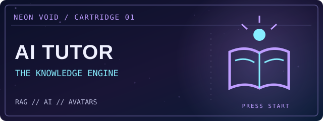
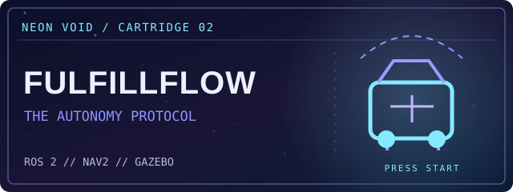
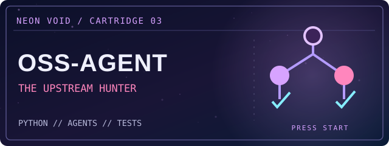
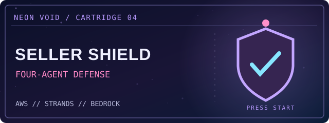
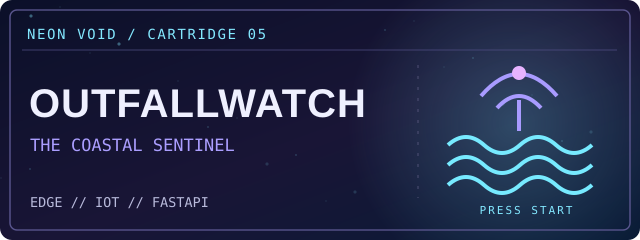
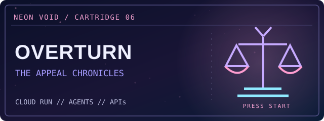
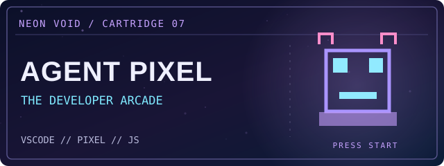
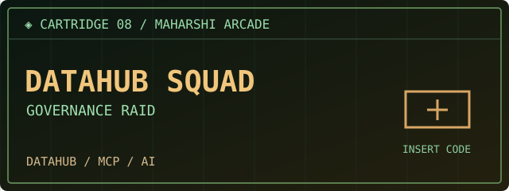

<div align="center">

<a href="https://maharshi-coding.github.io/maharshi-coding/"></a>


**`PLAYER 01`** · **`MAHARSHI BAROT`** · **`FULL-STACK MAGE / AI SUMMONER`**

[](https://maharshi-coding.github.io/maharshi-coding/)
[](#-level-03--game-library)
[](#-level-02--raid-log)

</div>

```text
╔══════════════════════════════════════════════════════════════════╗
║   MAHARSHI.EXE  [LOAD FILE 01]                 STATUS: ONLINE    ║
╠══════════════════════════════════════════════════════════════════╣
║  [01] CHARACTER SHEET    [02] RAID LOG       [03] GAME LIBRARY  ║
║  [04] SKILL TREE         [05] ACHIEVEMENTS   [06] SNAKE.exe     ║
╚══════════════════════════════════════════════════════════════════╝
```

<div align="center">

[**01 / PLAYER**](#-level-01--character-sheet) &nbsp; [**02 / QUESTS**](#-level-02--raid-log) &nbsp; [**03 / GAMES**](#-level-03--game-library) &nbsp; [**04 / SKILLS**](#-level-04--skill-tree) &nbsp; [**05 / STATS**](#-level-05--achievements--hud) &nbsp; [**06 / ARCADE**](#-level-06--the-snake-minigame)

</div>

---

## 🧙 LEVEL 01 // CHARACTER SHEET

```text
┌ PLAYER FILE ───────────────────────────────────────────────────────┐
│ NAME          Maharshi Barot                                      │
│ CLASS         Full-Stack Mage / AI Summoner                       │
│ BASE CAMP     Texas A&M University–Corpus Christi                │
│ ACADEMY       M.S. Computer & Information Science (in progress)  │
│ CLASS QUEST   Software Developer @ Meeka                         │
│ GUILD ROLE    Teaching Assistant                                 │
│ SPECIALTY     AI agents / robotics / developer tools / products   │
│ VICTORY       Real software. Real tests. Real upstream fixes.     │
└───────────────────────────────────────────────────────────────────┘
```

**Origin story:** I turn ideas into working systems — from autonomous warehouse robotics and LLM agents to real-time mobile applications, trustworthy APIs, and patches for existing open-source maintainers. I believe good engineering means making the happy path work *and* proving the failure path behaves.

> 🗞️ **Legendary side quest · RAMAYANAGPT:** A domain-specific AI conversational assistant listed in my earlier profile. No verified public repository or demo URL was found, so this quest has no invented CODE/PLAY link.

**Mission objective:** Build things that are useful, testable and genuinely fun to explore.  
**Quest-giver:** [Interactive portfolio](https://maharshi-os.netlify.app/) · [GitHub](https://github.com/maharshi-coding)

<details><summary><b>📜 OPEN CHARACTER BACKSTORY</b></summary>

- Graduate student at Texas A&M University–Corpus Christi.
- Teaching Assistant for undergraduate programming labs.
- Working across full-stack engineering, AI, robot autonomy and community-maintained code.
- The job at Meeka is shown as the **current quest you supplied**, not independently verified from GitHub.

</details>

---

## ⚔️ LEVEL 02 // RAID LOG

<code>SYNC PROTOCOL: GITHUB API</code> · <code>PUBLIC PRs ONLY</code> · <code>STATE-AWARE</code>

Bounties from other engineering guilds are marked **⚔️ upstream**. Work in my own public repositories is marked **🏠 home-base**. **Merged** means GitHub confirms the PR was merged, while **open** means it is still awaiting a decision.

<!--START_SECTION:prs-->
### ✅ MERGED // CLEARED BOUNTIES (8)

| Guild / Repository | Mission description | PR scroll |
| :-- | :-- | :-- |
| ⚔️ teslamotors/vehicle-command | tesla-http-proxy: exit 1 and report startup failures on stderr | [#524](https://github.com/teslamotors/vehicle-command/pull/524) |
| ⚔️ ros-navigation/navigation2 | Fix BtActionNode cancellation when halted before goal acknowledgement | [#6445](https://github.com/ros-navigation/navigation2/pull/6445) |
| 🏠 maharshi-coding/oss-agent | Interactive README + live GitHub Pages visualizer demo | [#1](https://github.com/maharshi-coding/oss-agent/pull/1) |
| 🏠 maharshi-coding/agent-pixel-visualizer | perf: fix 60fps rendering bottlenecks and event-listener leak in webview | [#1](https://github.com/maharshi-coding/agent-pixel-visualizer/pull/1) |
| 🏠 maharshi-coding/reinforcement-learning | Implement RL-Based Autonomous Intrusion Response System (AIRS) | [#1](https://github.com/maharshi-coding/reinforcement-learning/pull/1) |
| 🏠 maharshi-coding/ai-tutor-app | Integrate Ollama LLM, Kokoro TTS, SadTalker avatar, RAG document upload, and streaming | [#2](https://github.com/maharshi-coding/ai-tutor-app/pull/2) |
| 🏠 maharshi-coding/ai-tutor-app | Fix avatar image not displaying after generation due to stale state and browser cache | [#1](https://github.com/maharshi-coding/ai-tutor-app/pull/1) |
| 🏠 maharshi-coding/orlog-game | Optimize core game loop and React rendering performance | [#1](https://github.com/maharshi-coding/orlog-game/pull/1) |

### 🔶 OPEN // ACTIVE RAIDS (13)

| Guild / Repository | Mission description | PR scroll |
| :-- | :-- | :-- |
| ⚔️ teslamotors/vehicle-command | proxy: propagate vehicle request cancellation with startup cleanup | [#535](https://github.com/teslamotors/vehicle-command/pull/535) |
| ⚔️ google-deepmind/mujoco | Fix Studio native viewer on macOS: run the viewer on the main thread | [#3697](https://github.com/google-deepmind/mujoco/pull/3697) |
| ⚔️ facebook/mariana-trench | Fix false negative: taint propagation through static fields (#91) | [#277](https://github.com/facebook/mariana-trench/pull/277) |
| ⚔️ facebook/pyrefly | Preserve Unknown when narrowing missing attributes | [#5346](https://github.com/facebook/pyrefly/pull/5346) |
| ⚔️ moveit/moveit2 | Fix use-after-free in servo_keyboard_input demo by joining the spin thread | [#3850](https://github.com/moveit/moveit2/pull/3850) |
| ⚔️ facebook/ThreatExchange | [pdq][cpp] Prevent signed integer overflow in image downscaling | [#2026](https://github.com/facebook/ThreatExchange/pull/2026) |
| ⚔️ supabase/supabase | fix(studio): show removed edge functions in branch merge diff | [#44194](https://github.com/supabase/supabase/pull/44194) |
| ⚔️ teslamotors/react-native-camera-kit | fix(android): center scan frame after enabling and layout changes | [#822](https://github.com/teslamotors/react-native-camera-kit/pull/822) |
| ⚔️ waymo-research/waymax | Fix scenario ID batching in the WOSAC notebook | [#96](https://github.com/waymo-research/waymax/pull/96) |
| ⚔️ waymo-research/waymax | Clarify that rollout actors receive the full state; add observation-based actor test | [#95](https://github.com/waymo-research/waymax/pull/95) |
| ⚔️ waymo-research/waymax | Fix configured simulation actors in the dm_env factory | [#94](https://github.com/waymo-research/waymax/pull/94) |
| 🏠 maharshi-coding/face-attendance-app | Fix end-to-end: remove exposed key, green tests, clean frontend build | [#1](https://github.com/maharshi-coding/face-attendance-app/pull/1) |
| 🏠 maharshi-coding/ai-tutor-app | Fix end-to-end: green tests, clean builds across backend/frontend/mobile | [#3](https://github.com/maharshi-coding/ai-tutor-app/pull/3) |

_Initial GitHub API audit. This section is rewritten automatically by `scripts/generate_profile.py`._
<!--END_SECTION:prs-->

<details><summary><b>🗃️ WHAT ABOUT CLOSED / UNMERGED PRs?</b></summary>

They are **not** cleared bounties. [View the separate closed-without-merge history](https://github.com/pulls?q=is%3Apr+author%3Amaharshi-coding+is%3Aclosed+-is%3Amerged).

</details>

---

## 🎮 LEVEL 03 // GAME LIBRARY

**Insert cartridge. Inspect the code. Play the demo when one actually exists.** ⭐ means **GitHub stars**, not a made-up game review score. Only original **public** repositories are featured here; private work is not exposed.

<!--START_SECTION:projects-->
<table>
<tr>
<td width="50%" valign="top"><a href="https://github.com/maharshi-coding/ai-tutor-app"></a><p><b>AI Tutor</b> · ⭐ 0 stars</p><p>AI tutor with RAG, courses, and avatar-powered updates</p><p><code>TypeScript</code></p><a href="https://github.com/maharshi-coding/ai-tutor-app">⌘ CODE</a></td>
<td width="50%" valign="top"><a href="https://github.com/maharshi-coding/FulfillFlow"></a><p><b>FulfillFlow</b> · ⭐ 0 stars</p><p>ROS 2 warehouse navigation with verified single-robot baseline</p><p><code>Python</code></p><a href="https://github.com/maharshi-coding/FulfillFlow">⌘ CODE</a></td>
</tr>
<tr>
<td width="50%" valign="top"><a href="https://github.com/maharshi-coding/oss-agent"></a><p><b>OSS-Agent</b> · ⭐ 0 stars</p><p>Human-approved AI agent for meaningful upstream fixes</p><p><code>Python</code></p><a href="https://maharshi-coding.github.io/oss-agent/">▶ PLAY DEMO</a> &nbsp; · &nbsp; <a href="https://github.com/maharshi-coding/oss-agent">⌘ CODE</a></td>
<td width="50%" valign="top"><a href="https://github.com/maharshi-coding/seller-shield"></a><p><b>Seller Shield</b> · ⭐ 0 stars</p><p>Four-agent seller defense with AWS Bedrock and Strands</p><p><code>Python</code></p><a href="https://github.com/maharshi-coding/seller-shield">⌘ CODE</a></td>
</tr>
<tr>
<td width="50%" valign="top"><a href="https://github.com/maharshi-coding/outfallwatch"></a><p><b>OutfallWatch</b> · ⭐ 0 stars</p><p>Edge-powered coastal monitoring and storm simulation</p><p><code>TypeScript</code></p><a href="https://outfallwatch.onrender.com">▶ PLAY DEMO</a> &nbsp; · &nbsp; <a href="https://github.com/maharshi-coding/outfallwatch">⌘ CODE</a></td>
<td width="50%" valign="top"><a href="https://github.com/maharshi-coding/overturn"></a><p><b>Overturn</b> · ⭐ 0 stars</p><p>Persistent multi-agent appeal workflow on Cloud Run</p><p><code>TypeScript</code></p><a href="https://github.com/maharshi-coding/overturn">⌘ CODE</a></td>
</tr>
<tr>
<td width="50%" valign="top"><a href="https://github.com/maharshi-coding/agent-pixel-visualizer"></a><p><b>Agent Pixel Visualizer</b> · ⭐ 0 stars</p><p>Interactive pixel-art world for coding-agent activity</p><p><code>JavaScript</code></p><a href="https://github.com/maharshi-coding/agent-pixel-visualizer">⌘ CODE</a></td>
<td width="50%" valign="top"><a href="https://github.com/maharshi-coding/datahub-steward-squad"></a><p><b>DataHub Steward Squad</b> · ⭐ 0 stars</p><p>Governed metadata analysis and MCP writeback</p><p><code>Python</code></p><a href="https://github.com/maharshi-coding/datahub-steward-squad">⌘ CODE</a></td>
</tr>
</table>

<details><summary><b>🗄️ OPEN SIDE-QUEST SHELF (9 other original public repositories)</b></summary>

- [⌘ launchpad](https://github.com/maharshi-coding/launchpad)
- [⌘ maharshi-os](https://github.com/maharshi-coding/maharshi-os)
- [⌘ my-library](https://github.com/maharshi-coding/my-library)
- [⌘ face-attendance-app](https://github.com/maharshi-coding/face-attendance-app)
- [⌘ ai-tutoring](https://github.com/maharshi-coding/ai-tutoring)
- [⌘ insta-go-sdk](https://github.com/maharshi-coding/insta-go-sdk)
- [⌘ reinforcement-learning](https://github.com/maharshi-coding/reinforcement-learning)
- [⌘ orlog-game](https://github.com/maharshi-coding/orlog-game)
- [⌘ kinetic-darkroom](https://github.com/maharshi-coding/kinetic-darkroom)

</details>

<details><summary><b>🧬 OPEN FORK ARCHIVE (15 public upstream forks)</b></summary>

- [navigation2](https://github.com/maharshi-coding/navigation2)
- [moveit2](https://github.com/maharshi-coding/moveit2)
- [mariana-trench](https://github.com/maharshi-coding/mariana-trench)
- [KAN-ODEs](https://github.com/maharshi-coding/KAN-ODEs)
- [mujoco](https://github.com/maharshi-coding/mujoco)
- [insta-go-sdk-1](https://github.com/maharshi-coding/insta-go-sdk-1)
- [waymax](https://github.com/maharshi-coding/waymax)
- [click](https://github.com/maharshi-coding/click)
- [ThreatExchange](https://github.com/maharshi-coding/ThreatExchange)
- [supabase](https://github.com/maharshi-coding/supabase)
- [vehicle-command](https://github.com/maharshi-coding/vehicle-command)
- [marshmallow](https://github.com/maharshi-coding/marshmallow)
- [natsort](https://github.com/maharshi-coding/natsort)
- [react-native-camera-kit](https://github.com/maharshi-coding/react-native-camera-kit)
- [pyrefly](https://github.com/maharshi-coding/pyrefly)

</details>
<!--END_SECTION:projects-->

---

## ✨ LEVEL 04 // SKILL TREE

```text
                 [ ARCHITECTURE ]
                  /      |      \
          [ FRONTEND ] [ AI ] [ SYSTEMS ]
            /    \      / \      /   \
         REACT  TS   RAG  LLM  C++  ROS 2
               `UNLOCKED: BUILD → TEST → SHIP`
```

<details open><summary><b>⚔️ WEAPON SLOT // LANGUAGES</b></summary>

    

</details>

<details open><summary><b>🛡️ ARMOR SLOT // FRAMEWORKS</b></summary>

     

</details>

<details><summary><b>🔮 MAGIC SLOT // AI / LLM</b></summary>

   

</details>

<details><summary><b>🧰 TOOL SLOT // INFRASTRUCTURE & ROBOTICS</b></summary>

    

</details>

---

## 🏆 LEVEL 05 // ACHIEVEMENTS & HUD

<!--START_SECTION:hud-->
| HUD field | Verified API snapshot |
| :-- | :-- |
| 🎮 Account spawned | Pending profile API refresh |
| 📦 Public repositories | 33 |
| 🧬 Public forks | 15 |
| ⭐ Public repository stars | 1 |
| ⚔️ Authored public PRs (merged / open, current snapshot) | 8 / 13 |
| 🟩 Contributions in trailing 365 days | Pending authenticated GraphQL refresh |

**Language inventory:** Python, TypeScript, JavaScript, Go and HTML are present in original public repositories. Exact primary-language counts will be generated from the API.

**Pinned loadout:** Requires an authenticated GraphQL fetch; it will be populated automatically when available.
<!--END_SECTION:hud-->

<div align="center">


</div>

<details><summary><b>📊 READ THE HUD MANUAL</b></summary>

These widgets are third-party SVG services and may rate-limit or temporarily fail. Language panels measure repository makeup, not expertise; the high-score badge estimates page views. The API-derived HUD uses public repositories and exact PR states.

</details>

---

## 🐍 LEVEL 06 // THE SNAKE MINIGAME

<code>ARCADE > CONTRIBUTION_GRID > EAT_COMMITS.exe</code>

<div align="center">


_Snake appears after the scheduled GitHub Actions workflow successfully generates the output branch._

</div>

---

<div align="center">

```text
> status: BUILDING
> next mission: turn code into impact
> achievement unlocked: YOU FOUND THE CONSOLE
```

**[▶ LAUNCH FULL PLAYABLE TERMINAL](https://maharshi-coding.github.io/maharshi-coding/)** · **[⌘ SOURCE CODE](https://github.com/maharshi-coding?tab=repositories)** · **[⚔️ RAID HISTORY](https://github.com/pulls?q=is%3Apr+author%3Amaharshi-coding)**

_Meet me in the code._

</div>
