### Building dependable software, intelligent products, and practical AI systems.

**Software Engineer · Graduate Student at Texas A&M University–Corpus Christi · Teaching Assistant**

[Explore portfolio](https://maharshi-os.netlify.app/) &nbsp; · &nbsp;
[Interactive project explorer](https://maharshi-coding.github.io/maharshi-coding/) &nbsp; · &nbsp;
[All repositories](https://github.com/maharshi-coding?tab=repositories) &nbsp; · &nbsp;
[Pull requests](https://github.com/pulls?q=is%3Apr+author%3Amaharshi-coding)

---

## A little about me

I work across **full-stack development, AI agents, robotics, and developer tooling**, with a focus on shipping useful software rather than just prototypes. I like understanding how systems behave in real conditions, writing tests that catch edge cases, and contributing improvements back to open-source projects.

I'm pursuing an **M.S. in Computer & Information Science at Texas A&M University–Corpus Christi**, where I also support undergraduate programming labs as a Teaching Assistant. My interests include C++ systems, ROS 2, backend infrastructure, practical AI, and mobile/web products.

## Selected projects

A curated view of original public work. Each project links to its real repository; a live-demo link appears only where a verifiable demo exists. For filtering, searching, and exploring the complete collection, use the **[interactive project explorer](https://maharshi-coding.github.io/maharshi-coding/#projects)**.

<!--START_SECTION:projects-->
<table>
<tr>
<td width="50%" valign="top">

<a href="https://github.com/maharshi-coding/ai-tutor-app"><strong>ai-tutor-app</strong></a>

Your AI tutor, powered by retrieval, voice and avatars

TypeScript · ★ 0 GitHub stars

<a href="https://github.com/maharshi-coding/ai-tutor-app">Source code</a>

</td>
<td width="50%" valign="top">

<a href="https://github.com/maharshi-coding/FulfillFlow"><strong>FulfillFlow</strong></a>

Warehouse robot navigation powered by ROS 2 and Gazebo

Python · autonomous-navigation · cpp · ★ 0 GitHub stars

<a href="https://github.com/maharshi-coding/FulfillFlow">Source code</a>

</td>
</tr>
<tr>
<td width="50%" valign="top">

<a href="https://github.com/maharshi-coding/oss-agent"><strong>oss-agent</strong></a>

Human-approved AI agent for real open-source fixes

Python · agentic-ai · ai-agent · ★ 0 GitHub stars

<a href="https://github.com/maharshi-coding/oss-agent">Source code</a> &nbsp; · &nbsp; <a href="https://maharshi-coding.github.io/oss-agent/">Live demo</a>

</td>
<td width="50%" valign="top">

<a href="https://github.com/maharshi-coding/seller-shield"><strong>seller-shield</strong></a>

Multi-agent risk defense for independent sellers

Python · ★ 0 GitHub stars

<a href="https://github.com/maharshi-coding/seller-shield">Source code</a>

</td>
</tr>
<tr>
<td width="50%" valign="top">

<a href="https://github.com/maharshi-coding/outfallwatch"><strong>outfallwatch</strong></a>

Low-power coastal sensor alerts and storm simulation

TypeScript · edge-computing · environmental-monitoring · ★ 0 GitHub stars

<a href="https://github.com/maharshi-coding/outfallwatch">Source code</a> &nbsp; · &nbsp; <a href="https://outfallwatch.onrender.com">Live demo</a>

</td>
<td width="50%" valign="top">

<a href="https://github.com/maharshi-coding/overturn"><strong>overturn</strong></a>

Stateful agent workflows for insurance denial appeals

TypeScript · ★ 0 GitHub stars

<a href="https://github.com/maharshi-coding/overturn">Source code</a>

</td>
</tr>
<tr>
<td width="50%" valign="top">

<a href="https://github.com/maharshi-coding/agent-pixel-visualizer"><strong>agent-pixel-visualizer</strong></a>

Turns VS Code agent activity into a pixel-art world

JavaScript · ★ 0 GitHub stars

<a href="https://github.com/maharshi-coding/agent-pixel-visualizer">Source code</a>

</td>
<td width="50%" valign="top">

<a href="https://github.com/maharshi-coding/datahub-steward-squad"><strong>datahub-steward-squad</strong></a>

MCP-powered multi-agent metadata governance

Python · ai-agents · claude · ★ 0 GitHub stars

<a href="https://github.com/maharshi-coding/datahub-steward-squad">Source code</a>

</td>
</tr>
</table>

<b>Browse 9 more original public repositories</b>

| Repository | Primary language | Stars | Links |
| :-- | :-- | --: | :-- |
| **ai-tutoring** —  | Unspecified | 0 | [Code](https://github.com/maharshi-coding/ai-tutoring) |
| **face-attendance-app** —  | TypeScript | 0 | [Code](https://github.com/maharshi-coding/face-attendance-app) |
| **insta-go-sdk** —  | Go | 0 | [Code](https://github.com/maharshi-coding/insta-go-sdk) |
| **kinetic-darkroom** — A gesture-controlled photo puzzle and digital darkroom. Built on Hand-Puzzle with original | Unspecified | 0 | [Code](https://github.com/maharshi-coding/kinetic-darkroom) |
| **launchpad** — Interactive 3D launcher — try Maharshi&#x27;s AI-agent projects live or view the code | HTML | 0 | [Code](https://github.com/maharshi-coding/launchpad) |
| **maharshi-os** — Interactive neon-noir portfolio of Maharshi Barot — AI Solutions Developer &amp; Full-Stack En | TypeScript | 0 | [Code](https://github.com/maharshi-coding/maharshi-os) |
| **my-library** —  | TypeScript | 0 | [Code](https://github.com/maharshi-coding/my-library) |
| **orlog-game** —  | JavaScript | 0 | [Code](https://github.com/maharshi-coding/orlog-game) |
| **reinforcement-learning** —  | HTML | 0 | [Code](https://github.com/maharshi-coding/reinforcement-learning) |

Open the 15-repository public fork archive

_Forks are shown separately from original projects._

- [click](https://github.com/maharshi-coding/click)
- [insta-go-sdk-1](https://github.com/maharshi-coding/insta-go-sdk-1)
- [KAN-ODEs](https://github.com/maharshi-coding/KAN-ODEs)
- [mariana-trench](https://github.com/maharshi-coding/mariana-trench)
- [marshmallow](https://github.com/maharshi-coding/marshmallow)
- [moveit2](https://github.com/maharshi-coding/moveit2)
- [mujoco](https://github.com/maharshi-coding/mujoco)
- [natsort](https://github.com/maharshi-coding/natsort)
- [navigation2](https://github.com/maharshi-coding/navigation2)
- [pyrefly](https://github.com/maharshi-coding/pyrefly)
- [react-native-camera-kit](https://github.com/maharshi-coding/react-native-camera-kit)
- [supabase](https://github.com/maharshi-coding/supabase)
- [ThreatExchange](https://github.com/maharshi-coding/ThreatExchange)
- [vehicle-command](https://github.com/maharshi-coding/vehicle-command)
- [waymax](https://github.com/maharshi-coding/waymax)

<!--END_SECTION:projects-->

## Open-source contributions

Selected public pull requests to repositories maintained by **Tesla, Meta, Google DeepMind, and Waymo**. Each company has its own section for **GitHub-merged**, **landed upstream through CodeSync**, and **open** contributions. PRs from my personal repositories and unrelated projects are excluded.

<!--START_SECTION:prs-->
### [Tesla](https://github.com/teslamotors)

**Merged on GitHub**

- **vehicle-command** · [PR #524](https://github.com/teslamotors/vehicle-command/pull/524) — tesla-http-proxy: exit 1 and report startup failures on stderr

**Open · under review**

- **vehicle-command** · [PR #535](https://github.com/teslamotors/vehicle-command/pull/535) — proxy: propagate vehicle request cancellation with startup cleanup
- **react-native-camera-kit** · [PR #822](https://github.com/teslamotors/react-native-camera-kit/pull/822) — fix(android): center scan frame after enabling and layout changes

### [Meta](https://github.com/facebook)

**Landed upstream via Meta CodeSync**

- **mariana-trench** · [PR #277](https://github.com/meta/mariana-trench/pull/277) — Fix false negative: taint propagation through static fields (#91) · [Upstream commit 81b835d](https://github.com/meta/mariana-trench/commit/81b835dff56763b871d9db8dcbf29bdb1bb35973)

### [Google DeepMind](https://github.com/google-deepmind)

**Open · under review**

- **mujoco** · [PR #3697](https://github.com/google-deepmind/mujoco/pull/3697) — Fix Studio native viewer on macOS: run the viewer on the main thread

### [Waymo](https://github.com/waymo-research)

**Open · under review**

- **waymax** · [PR #96](https://github.com/waymo-research/waymax/pull/96) — Fix scenario ID batching in the WOSAC notebook
- **waymax** · [PR #95](https://github.com/waymo-research/waymax/pull/95) — Clarify that rollout actors receive the full state; add observation-based actor test
- **waymax** · [PR #94](https://github.com/waymo-research/waymax/pull/94) — Fix configured simulation actors in the dm_env factory

_GitHub merge and Meta CodeSync integration are labeled separately. These are public open-source contributions—not company employment or endorsement._
<!--END_SECTION:prs-->

## Experience & focus

| Focus | Technologies and work |
| :-- | :-- |
| **Backend & platform engineering** | Python, Node.js, FastAPI, REST APIs, PostgreSQL, Firebase, cloud deployments |
| **Web & mobile** | React, React Native, Next.js, TypeScript, interface design and integrations |
| **AI engineering** | AI agents, LLM workflows, retrieval, evaluations, human-in-the-loop automation |
| **Systems & robotics** | C++, ROS 2, Nav2, Gazebo, autonomous navigation, testing and debugging |
| **Engineering practices** | GitHub Actions, automated tests, regression coverage, documentation and code review |

## GitHub activity

<!--START_SECTION:hud-->
| Public GitHub activity | Count |
| :-- | --: |
| Public repositories | 33 |
| Original repositories | 18 |
| Total public repository stars | 1 |
| Integrated contributions to featured tech companies | 2 |
| Open PRs to featured tech companies | 6 |
| Contributions in last 365 days | 277 |

**Primary repository languages:** TypeScript (6), Python (5), JavaScript (2), HTML (2), Go (1)
<!--END_SECTION:hud-->

<b>Explore more GitHub statistics</b>

_Public contribution and language metrics can differ between GitHub API sources and third-party widgets._

---

**Interested in collaborating?**

[See my work](https://maharshi-coding.github.io/maharshi-coding/) · [Browse code](https://github.com/maharshi-coding?tab=repositories) · [Explore contributions](https://github.com/pulls?q=is%3Apr+author%3Amaharshi-coding)

Designed to stay clear, accessible, and grounded in real GitHub data.

